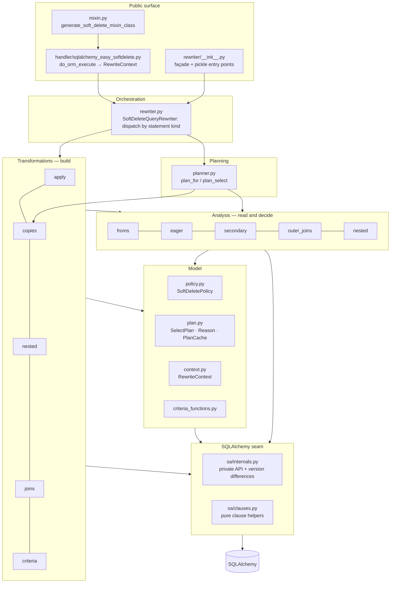
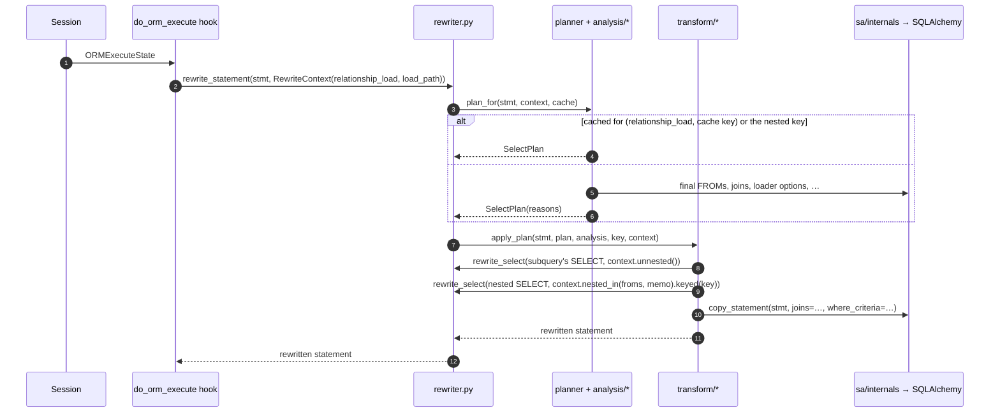
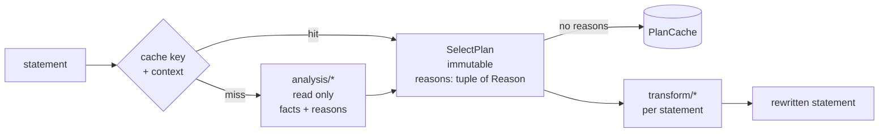

# Architecture

`sqlalchemy-easy-softdelete` filters soft-deleted rows out of ORM SELECTs. A `do_orm_execute` hook hands each
statement to `SoftDeleteQueryRewriter`, which returns a rewritten copy. The original is never modified.

The rewriter lives in `sqlalchemy_easy_softdelete/handler/rewriter/`. This page describes how it is organized,
and the rules that keep it that way. `tools/check_layers.py` checks those rules on every lint run.

## Layers

A module may import from its own layer or from the layers below it, never from above.



| Layer | Modules | What they do |
|---|---|---|
| Façade | `__init__.py` | Re-exports the public names (`SoftDeleteQueryRewriter`, `RewriteCacheInfo`, `DEFAULT_REWRITE_CACHE_SIZE`, `RewriteContext`, `RELATIONSHIP_LOAD`, `LOAD_PATH`). It also keeps the names that pickled instances refer to. |
| Orchestration | `rewriter.py` | `SoftDeleteQueryRewriter` dispatches by statement kind: SELECT, union, `from_statement()`, `lambda_stmt()`. It owns the policy and the plan cache. |
| Planning | `planner.py` | `plan_for()` returns a remembered plan for the statement's shape, or makes one with `plan_select()` from what `analysis/` finds. |
| Transformations | `transform/` | `apply.apply_plan()` builds the rewritten statement from a plan, one step at a time: filtered copies of subqueries (`copies`), nested SELECTs (`nested`), loader criteria (`criteria`), then ON-clause and WHERE filters (`joins`). |
| Analysis | `analysis/` | These modules read a statement and never build one. They cover the FROM clause (`froms`), eager loading and the mapping (`eager`), soft-deletable secondaries (`secondary`), outer joins (`outer_joins`), and nested SELECTs and correlation (`nested`). |
| Model | `policy.py`, `plan.py`, `context.py`, `criteria_functions.py` | What the configuration decides, what a plan holds, where a statement sits, and the loader criteria function. |
| SQLAlchemy seam | `sa/internals.py`, `sa/clauses.py` | The only modules that read or write SQLAlchemy's private attributes (`_setup_joins`, `_where_criteria`, …). Version differences are listed at the top of `internals.py`. |

## One execution



A rewrite is recursive. A subquery's statement, a CTE's statement, the SELECTs nested in WHERE/HAVING/ON, and the
members of a union are each rewritten like statements of their own. What changes from one level to the next is
the `RewriteContext`, which is passed explicitly and derived at each level:

| Field | Set where | Meaning |
|---|---|---|
| `relationship_load`, `load_path` | the hook | A relationship load leaves aliases of tables unfiltered, and only counts the loader options on its own path. |
| `enclosing_froms`, `copy_memo` | `nested_in()`, for nested SELECTs | What the nested SELECT correlates to, and the enclosing statement's filtered copies, which it shares. |
| `nested_key` | `keyed()` | The key a nested SELECT's or union member's plan is remembered by: the enclosing statement's key plus the position. |
| `in_lateral` | `lateral()` | Inside a LATERAL subquery, references to another LATERAL subquery's columns are correlations. |
| `ctes_in_rewrite` | `in_ctes()` | Inside a recursive CTE's statement, references to the CTE itself are left as they are. |
| (reset) | `unnested()` | The statement of a FROM subquery or CTE correlates to nothing and makes copies of its own. |

## Two phases, one cacheability rule



A plan is remembered by the statement's cache key only when it holds for every statement with that key. Each case
where it doesn't is a `Reason` in `plan.py`, with its explanation, for example `SUBQUERY_IN_LOADER_PATH`,
`IMPLICIT_JOIN_LEFTS` or `ON_CLAUSE_REFERS_TO_STATEMENT`. A plan with reasons is used once and counted as
`uncacheable` in `rewrite_cache_info()`. When adding a case that depends on something cache keys leave out
(execution options, the statement's own objects), add a `Reason`.

## Rules

1. **Layers** as above. Imports under `if TYPE_CHECKING:` are for type checkers only.
2. **No import cycles.**
3. **SQLAlchemy's private API only in `sa/`.** Elsewhere, use the named accessors of `sa/internals.py`
   (`internals.joins(stmt)`, `internals.copy_statement(stmt, where_criteria=…)`, …). A new SQLAlchemy release is
   checked against that module.
4. **Analysis never builds a statement; transformations never decide whether a plan is reusable.**
5. **Pickle compatibility.** Pickled instances refer to `sqlalchemy_easy_softdelete.handler.rewriter._unpickle_*`
   and `_is_not_soft_deleted_<hex>`. Those names stay resolvable there, and new pickles refer to them too.

Rules 1 to 3 are checked by `python tools/check_layers.py`, which runs as a pre-commit hook (`make lint`).

## Guardrails for refactoring

A change that should not change behavior can be checked beyond the test suite:

- **Rewrite fingerprint.** It records every rewrite the test suite performs (input SQL, output SQL for PostgreSQL
  and SQLite, the cache counters) and compares the result with a base commit. The plugin is
  `tools/rewrite_fingerprint.py`:

  ```bash
  python tools/fingerprint.py record base.jsonl --code /path/to/base/checkout [--python ...] [--db URL]
  python tools/fingerprint.py record new.jsonl  [--python ...] [--db URL]
  python tools/fingerprint.py compare base.jsonl new.jsonl
  ```

- **Golden pickles.** `python tools/golden_pickles.py check` loads instances pickled by the version before the
  rewriter became a package (in `tools/golden_pickles/`, one directory per SQLAlchemy release line) and checks
  their lazy loads.
- **Benchmarks.** `python benchmarks/bench_rewrite.py` prints µs per statement (warm and cold rewrite, full
  execution) for about 20 statement shapes. `python benchmarks/ab.py BASE_DIR NEW_DIR` alternates two checkouts
  and applies the gates: rewrites at most 1.05× the base, executions at most 1.03×.
