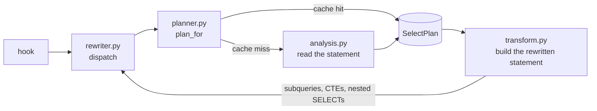

# Architecture

A `do_orm_execute` hook (`handler/sqlalchemy_easy_softdelete.py`) hands each ORM SELECT to
`SoftDeleteQueryRewriter`, which returns a filtered copy. The original statement is never modified.

A SELECT is rewritten in two steps. The planner reads it and makes a `SelectPlan`, remembered by the statement's
cache key; the transformations build the rewritten statement from the plan. The statements inside it (subqueries,
CTEs, nested SELECTs, union members) are rewritten the same way, recursively.

| Module | Holds |
|---|---|
| `rewriter.py` | `SoftDeleteQueryRewriter`: dispatch by statement kind (SELECT, union, `from_statement()`, `lambda_stmt()`). |
| `planner.py` | `plan_for()`: a cached plan for the statement's shape, or a new one from the analysis. |
| `analysis.py` | Reading a statement: FROM clause, eager loading and the mapping, secondaries, outer joins, nested SELECTs. |
| `transform.py` | Building the rewritten statement: filtered copies, nested SELECTs, loader criteria, ON and WHERE filters. |
| `policy.py` | What the configuration decides: soft-deletable tables and classes, their conditions, disabled statements. |
| `plan.py` | `SelectPlan`, the `Reason`s a plan is not cached, the plan cache, and `RewriteContext`. |
| `clauses.py` | Helpers over SQLAlchemy clauses and FROM elements. |

Imports go one way: `rewriter` → `planner` → `transform` → `analysis` → `policy`, `plan` → `clauses`.

**`RewriteContext`** says where the statement being rewritten sits. Each level of the recursion derives its own:

- `nested_in()`: what a nested SELECT correlates to, and the copies it shares with the enclosing statement;
- `keyed()`: the key its plan is cached by (the enclosing statement's key and its place in it);
- `unnested()`: a subquery or CTE in a FROM clause correlates to nothing;
- `lateral()` and `in_ctes()`: what is inside a LATERAL subquery, or a CTE's own statement.

The hook sets `relationship_load` and `load_path` for relationship loads.

**Caching.** A plan is cached only when it holds for every statement with the same cache key. Each case where it
doesn't (it depends on execution options, or on the statement's own aliases and subqueries) is a `Reason` in
`plan.py`; such a plan counts as `uncacheable` in `rewrite_cache_info()`.

**SQLAlchemy versions.** Differences between supported releases are handled where they apply, each with a comment:

- `is_select` before 2.0.30: the hook;
- `compare()` before 2.0.32: `clauses.same_expression`;
- `get_final_froms()` on 2.1: `planner._own_froms`;
- loader criteria on correlated classes on 2.1.0: `transform.rewrite_nested_selects`.

**Pickles.** Pickled instances refer to `_unpickle_*` and `_is_not_soft_deleted_<hex>` at
`sqlalchemy_easy_softdelete.handler.rewriter`, which re-exports them; that path must not change.
